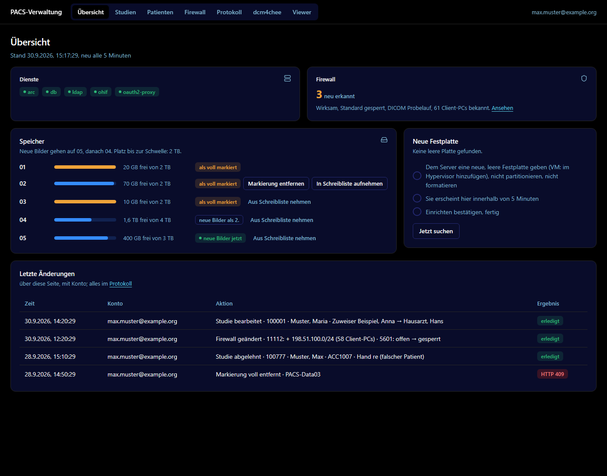
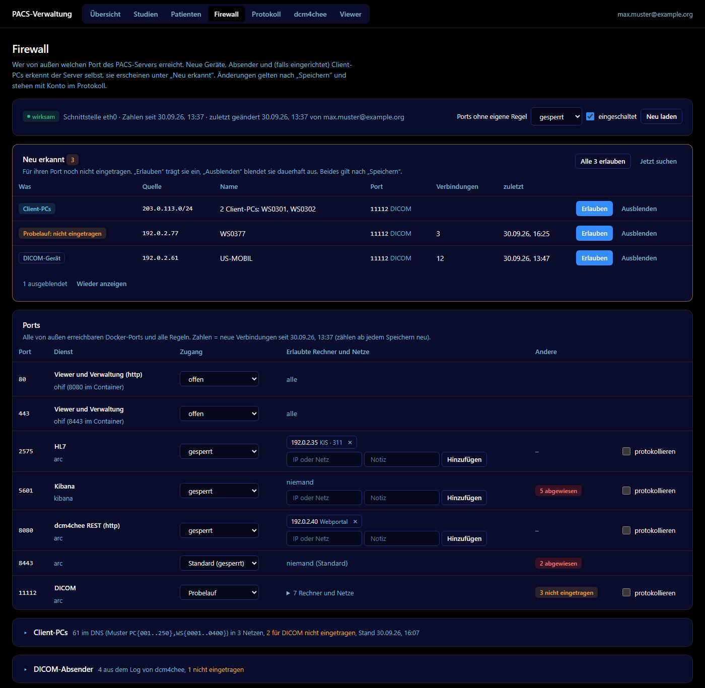
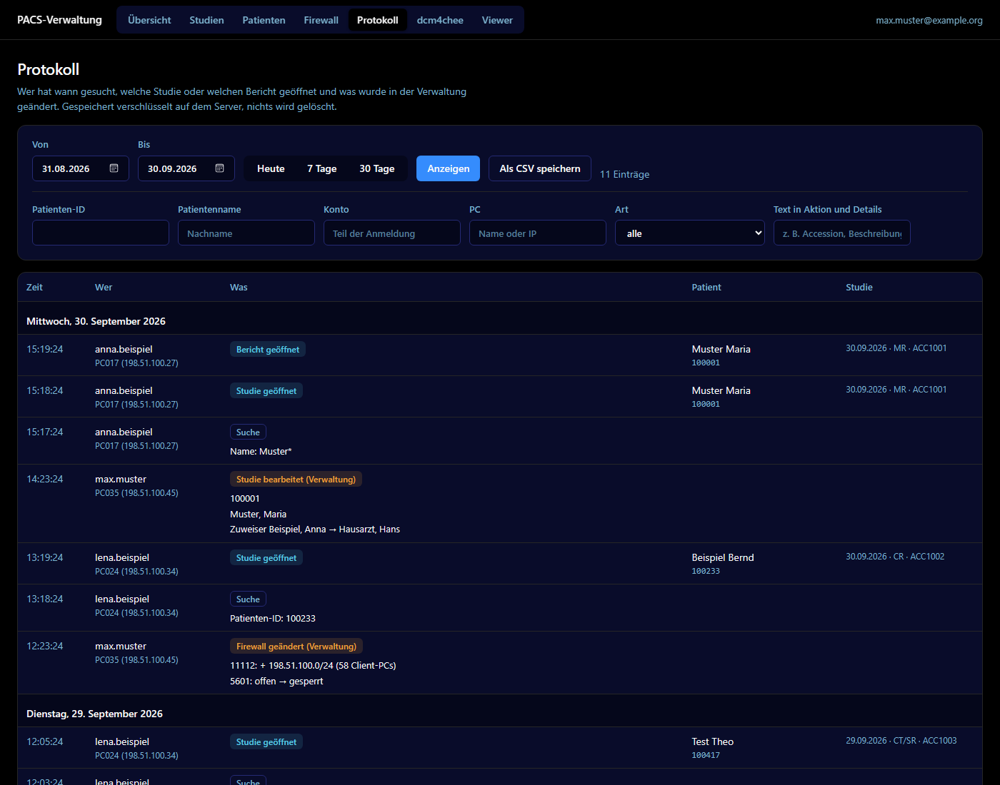
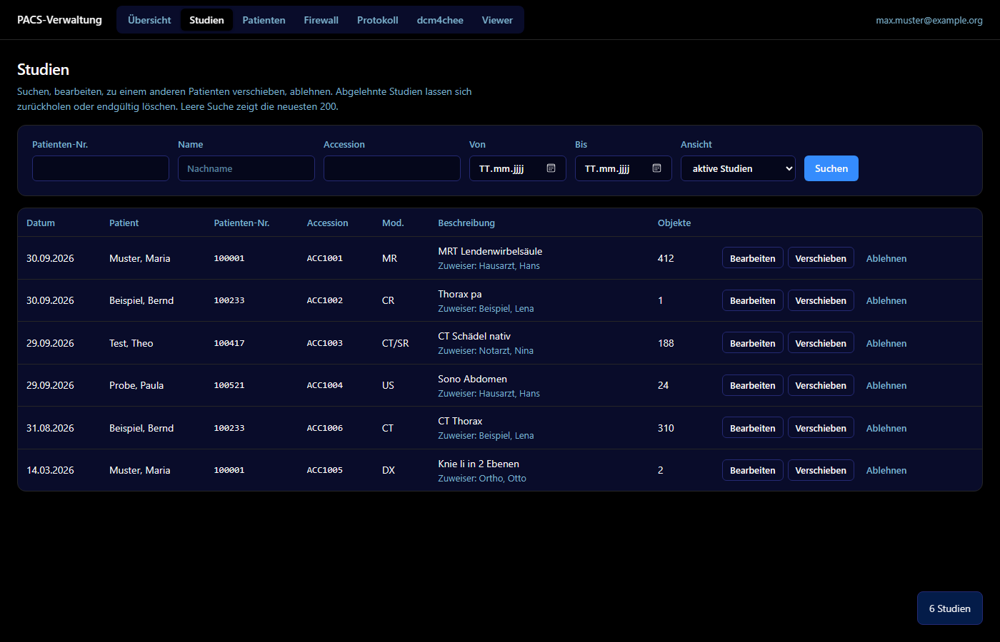

# dcm4chee-admin-panel

English | [Deutsch](README.de.md)

<a id="what-it-is"></a>
## What it is

The admin panel is one web page for a dcm4chee-arc-light archive that runs in Docker Compose. It shows disks and services, searches and edits studies and patients, controls the firewall of the Docker ports and keeps an encrypted audit log. nginx serves the page and checks the login, and a small helper service on the host does what a browser cannot: add disks, set iptables rules and write the log.

The page is in German. The guides and the install tools are in English and German. A demo with made-up data runs on any PC in 5 minutes ([path A](#choose-your-path)).

<a id="screenshots"></a>
## Screenshots









<a id="features"></a>
## Features

<a id="feature-overview"></a>
### Übersicht (overview)

- Disks of the archive with fill level and free space. The page shows which disk gets new images now and which disks follow. The order is the [write list](docs/glossary.md#write-list) of the archive AE (`dcmObjectStorageID` and `dcmMetadataStorageID`). When the space left until the disks count as full drops below `STORAGE_WARN_GB` (default 300 GB), the page asks for a new disk.
- Write list:
  - `In Schreibliste aufnehmen` adds a disk at the end of the list.
  - `Aus Schreibliste nehmen` removes a disk from the list. Its images stay readable. The page hides the button on the last disk that takes new images, and `pacs-storage.sh` refuses to remove the last storage that is not marked full.
  - `Markierung entfernen` clears the full mark (`dcmStorageThresholdExceeded`) that dcm4chee sets at the threshold.
  - Adding and clearing need at least `STORAGE_FREE_GB` free on the disk (default 50 GB). The page shows these two buttons only on disks with at least that much free space (`frei_gb` in `status.json`), and `pacs-storage.sh` checks again.
- New disk: give the server (or VM) a blank disk. It shows up within 5 minutes, or at once with `Jetzt suchen`. After you confirm, `pacs-storage.sh` formats it as ext4, mounts it under `STORAGE_BASE`, adds it to `/etc/fstab`, creates the storage in LDAP as a copy of the current one and appends it to the write list. The page shows each step and the script output.
- The containers of the dcm4chee Compose project, running or stopped.
- Firewall tile: on or off, default mode, mode of the DICOM port, number of client PCs, IPv6 warning and number of newly detected sources.
- The last 15 changes made through the page, with account.

<a id="feature-studies"></a>
### Studien (studies)

- Search by patient ID, name, accession number and date range (`Von`, `Bis`). Choose between active and rejected studies. The newest studies come first, up to 200 results.
- Edit description, accession number, study date and referring physician. dcm4chee keeps the old values in the Original Attributes Sequence.
- Move a study to another patient. Name and birth date of the target patient stay as they are.
- Reject a study (`113001^DCM`). In the view of rejected studies, restore a study or delete it permanently. Deleting asks you to type the accession number (or the patient ID) first.

<a id="feature-patients"></a>
### Patienten (patients)

- Search by patient ID and name, up to 100 results.
- Edit name, birth date and sex. The page sends the whole record back, so address and other attributes stay.
- Merge two patient entries.
- A hint warns that the next HL7 ADT message overwrites edits for patients that the hospital information system feeds.

<a id="feature-firewall"></a>
### Firewall

- iptables rules for every port that Docker publishes. Each port has one mode: `offen` (everyone gets through), `Probelauf` (dry run: everyone gets through, sources not on the list are logged) or `gesperrt` (only listed IPv4 addresses and networks).
- A default mode for ports without a rule. It also covers ports that Docker publishes later.
- Ports that Docker also publishes on IPv6 get the badge `IPv6 nicht gefiltert`, see [Limitations](#limitations).
- The web, DICOM and HL7 ports are settings (`FW_WEB_PORTS`, `FW_DICOM_PORTS`, `FW_HL7_PORTS`), for sites that publish DICOM on 104 or the viewer on another port.
- `Neu erkannt` (newly detected) lists sources that were seen but are not allowed for their port. Each entry has the buttons `Erlauben` (allow) and `Ausblenden` (hide). Sources come from the `server.log` of dcm4chee (DICOM and HL7 senders, read every 5 minutes), from the kernel log (connections that the rules logged, last 7 days) and from client PC discovery.
- Client PC discovery looks up DNS names built from patterns such as `pc{01..20},ws{001..040}` (`FW_CLIENT_NAMES`). It suggests one /24 network per group of PCs for the first DICOM port. An empty pattern means no lookups, and the card is hidden.
- Counters of new connections per port and source.
- `Speichern` (save) applies the changes. The service refuses a rule set that would lock the saving PC out of the first web port (https). It keeps the previous version in `PACS_DIR/firewall/` and goes back to it if applying fails.

<a id="feature-audit"></a>
### Protokoll (audit log)

- Who searched for studies or patients, who opened which study or report (in the viewer, on this page or in the dcm4chee UI section), and every change made through the page, with account, PC and time.
- Filters: date range (`Von`, `Bis`, `Heute`, `7 Tage`, `30 Tage`), patient ID, patient name, account, PC, type of entry and free text. The same account with the same study or search within 30 minutes counts as one entry. Each repeat restarts the 30 minutes, and changes are never merged. The page shows the 2000 newest entries.
- CSV export for Excel (semicolon, UTF-8 with BOM).
- Stored encrypted with SQLCipher on the server. Every single request is stored too (source `zugriffe`) and can be read with `server/pacsdb.py`.

<a id="feature-settings"></a>
### Header and page settings

The header links to the dcm4chee UI and to the viewer. It shows the account of the signed-in user and, if you set a sign-out address, the link `Abmelden` (sign out). Title, AE titles, links, an optional logo, the address that supplies the account name (`kontoUrl`), the sign-out link (`abmeldenUrl`) and the locale for numbers and timestamps come from `web/admin/config.js` ([reference](docs/reference.md#config-js)). When the login session ends, the page shows `Sitzung abgelaufen, Seite neu laden (F5)` (session expired, reload the page) instead of an error message of the browser.

<a id="choose-your-path"></a>
## Choose your path

| Path | Use it for | You need | Start |
|---|---|---|---|
| **A. Demo** | A first look in 5 minutes | Python 3.7 or newer on any PC | [Demo](docs/install.md#demo) |
| **B. Real install with single sign-on** | Daily use with Microsoft Entra ID or another OpenID Connect provider | A server, a DNS name, a TLS certificate and the right to register an app at the provider | [Real install](docs/install.md#real-install), [login with oauth2-proxy](docs/login.md#login-oauth2), [Entra ID](docs/login.md#login-oauth2-entra) |
| **C. Real install without OAuth proxy** | Daily use with accounts kept by nginx, or a closed network | A server, a DNS name and a TLS certificate | [Real install](docs/install.md#real-install), [login basic](docs/login.md#login-basic), [login none](docs/login.md#login-none) |

The install guide compares the paths in [Pick your path](docs/install.md#pick-path). If you cannot decide on a login, read [Choose a login](docs/login.md#login-choose).

The demo runs the real page with made-up data. It needs no dcm4chee, no login and no root rights.

```bash
git clone https://github.com/pbaetz99/dcm4chee-admin-panel.git
cd dcm4chee-admin-panel
python3 demo/serve.py
```

Open `http://127.0.0.1:8000/admin/`. The demo guide lists the options ([path A](docs/install.md#demo)).

Variants of the real install:

- [Admin panel only](docs/install.md#variant-adminonly), without the OHIF viewer.
- [Behind your own TLS proxy](docs/install.md#variant-proxied) such as Traefik, Caddy, Apache or Cloudflare Tunnel.
- [nginx on the host](docs/install.md#nginx-on-host) instead of in a container.
- [A first look through an SSH tunnel](docs/install.md#variant-tryit), without TLS.

The base install does not change your dcm4chee project and does not restart it. The two optional modules, the disk assistant and the firewall, change its compose file and recreate the container `arc`. Plan a maintenance window for them ([optional modules](docs/install.md#optional-modules)).

<a id="how-it-works"></a>
## How it works

```text
Browser --https--> nginx, the front door (container ohif)
                     |
                     +-- login check --> oauth2-proxy (container ohif-auth) --> Entra ID or other OIDC provider
                     |                   (or user files of nginx: login basic, or network lists: login none)
                     +-- /                the OHIF viewer (optional)
                     +-- /admin/          static page (web/admin, read-only mount)
                     +-- /admin/daten/    status.json, written by dashboard-status.py (cron, every 5 minutes)
                     +-- /admin/dienst/   unix socket --> verwaltung-dienst.py (root, on the host)
                     |                                      +-- pacs-storage.sh  disks, LDAP
                     |                                      +-- firewall.py      iptables
                     |                                      +-- pacsdb.py        audit log (SQLCipher)
                     +-- /dcm4chee-arc/   allow-listed REST calls --> dcm4chee-arc
                     +-- access log as syslog --> unix socket --> verwaltung-dienst.py --> audit log
```

- The page is plain HTML, JavaScript and CSS. It has no build step, no CDN and no external fonts. nginx serves it straight from the repository directory.
- Front door: nginx checks every request ([glossary](docs/glossary.md#front-door)). Three parts are exchangeable: the login (`oauth2-proxy`, `basic` or `none`), the viewer (`ohif` or `none`) and the listener (`tls`, `plain` or `behind-proxy`). The nginx files are in `deploy/nginx`. Five compose files in `deploy/compose` combine them to recipes ([recipes](deploy/nginx/README.md#recipes), [table](docs/reference.md#nginx-recipes)).
- Two levels: any account that the login lets in may open the viewer and read. An admin may also open `/admin/` and change data.
- dcm4chee REST: nginx passes only the calls that the viewer and the page use. Everything else under `/dcm4chee-arc/` answers 404. Changes need the admin level and the header `X-PACS-Admin`, which the page sets with a readable description for the log. nginx adds locks, see [Security notes](#security-notes).
- Helper service: `server/verwaltung-dienst.py` runs as root on the host (unit `pacs-verwaltung`) and listens on two unix sockets only. nginx passes the account in `X-Auth-User` and the client address in `X-Real-IP`. The service runs `pacs-storage.sh` for disks and `firewall.py` for iptables, and it reads the audit log ([glossary](docs/glossary.md#helper-service)).
- Audit log: nginx sends one JSON line per request by syslog to the second unix socket. The service collects the lines and writes them to the SQLCipher database every 2 seconds. The tags are `zugriffe` (every request), `ereignisse` (study and patient searches, opened studies) and `admin` (changes, with description and new values).
- `server/dashboard-status.py` runs from cron every 5 minutes and writes `status.json`: disks, blank disks, containers. It holds no patient data.
- `server/firewall.py` keeps its rules in the chain `PACS-SPERRE`, which `DOCKER-USER` jumps to for the incoming interface. `pacs-firewall.service` applies them after every Docker start.
- Optional: the file `optional/dcm4chee-ui.conf` serves the dcm4chee UI through the same login, without Keycloak, for the admin level only. Changes made there go into the audit log. Delete the file to switch the section off.

<a id="requirements"></a>
## Requirements

- dcm4chee-arc-light in Docker Compose, running without Keycloak. The `-secure` images are not supported. nginx does the access control.
- A Linux host with systemd and root access. Debian 12 and Debian 13 were tested. Ubuntu uses the same packages and was not tested.
- Python 3.7 or newer at `/usr/bin/python3`. The server programs use the standard library only.
- Docker with the Compose plugin (`docker compose`), iptables and cron.
- nginx 1.25.1 or newer. The Docker images bring it. For nginx on the host see [nginx on the host](deploy/nginx/README.md#host-nginx).
- The SQLCipher library for the audit log: `libsqlcipher1` on Debian 13, `libsqlcipher0` on Debian 12 and older.
- For the disk assistant: `util-linux`, `e2fsprogs` and `curl`. The LDAP container needs its root password in its own environment (`LDAP_ROOTPASS` or `LDAP_ROOTPASS_FILE`). The arc container needs `STORAGE_BASE` mounted with `:rslave` ([disk assistant](docs/modules.md#disk-assistant)).
- For path B: an OpenID Connect provider and the container oauth2-proxy, which the compose file sets up.

The [package table](docs/reference.md#packages) lists every tool and package. `deploy/tools/preflight.sh` checks a host before you start. It only reads and changes nothing.

<a id="tested"></a>
## What was tested and how

The nginx recipes, the tools and the changed server code were tested in local Docker containers on one PC, with stand-ins for the parts that were not at hand. No installed PACS server, no real identity provider and no real dcm4chee-arc took part.

Tested:

- **nginx recipes.** A lab of throw-away containers ran the real helper service, a stand-in for dcm4chee-arc that echoes what reaches it, a stand-in for oauth2-proxy, the nginx under test and a client with about 370 checks per recipe. The checks cover every lock, the Referer rule, the removal of headers and the audit log from the request to the database. `nginx -t` ran for all 18 combinations of login, viewer and listener, with and without the dcm4chee UI file. nginx from the Debian 13 packages (1.26) ran with the real helper service. On Debian 12 (nginx 1.22) only `nginx -t`, one HTTP/2 request and the redirect ran. Details: [test lab](deploy/nginx/README.md#lab).
- **Tools.** `preflight.sh`, `pacs-adduser.sh` and `set-aet.sh` ran in Debian 12 and Debian 13 containers, with stand-ins for `docker`, `systemctl` and other commands. `preflight.sh` also ran against a real Docker engine (Docker Desktop on Windows).
- **Audit log.** `pacsdb.py` opened databases with `libsqlcipher0` 3.4.1 (Debian 12) and `libsqlcipher1` 4.6.1 (Debian 13), written by either library.
- **Python.** The server programs ran with Python 3.7 (a Debian 10 chroot), 3.11 and 3.12.
- **Page.** The page and the demo ran in a browser based on Chromium.
- **Earlier version.** The first version of the page, the helper service, the disk assistant and the firewall ran in daily use with dcm4chee-arc-light 5.35.1, Docker 26 and iptables-nft on Debian 10, in the nginx of the OHIF image behind oauth2-proxy and Microsoft Entra ID. The nginx recipes of this version are new.

Not tested:

- A real identity provider such as Microsoft Entra ID, and a real oauth2-proxy. The stand-in answers like oauth2-proxy (202, 401, 403 and the `X-Auth-Request-*` headers). No real browser login flow ran: sign in, sign out, redirects and cookies.
- A real dcm4chee-arc with WildFly. The stand-in only echoes, and the patterns of the study locks ran against it. Read-only searches on a real arc (version 5.35) showed that a second `StudyInstanceUID` and a comma list in one select several studies, which is why the locks allow one exact form; the update call itself was not tried with them. Not confirmed against a real arc: that the guard for `;`, `%5c` and a raw backslash stops what it should, and that the dcm4chee UI section works without the cookie.
- The OHIF image. The recipes with the viewer `ohif` ran on the plain `nginx` image. The key rule for the OHIF image (nginx master as uid 101) was tested with a master started as uid 101.
- Real systemd. The units were checked with `systemd-analyze verify` and were not started.
- The disk assistant with real disks and a real LDAP after the changes of this version. Only the plan and the early checks ran, with stand-ins.
- Ubuntu, Firefox, Safari, Docker on a Linux host (the lab ran on Docker Desktop), and a real Traefik, Caddy, Apache or Cloudflare Tunnel in front of nginx (a second nginx played the proxy).

<a id="limitations"></a>
## Limitations

- The page and the server programs speak German only. The guides and the tools `preflight.sh`, `pacs-adduser.sh` and `set-aet.sh` speak English and German.
- One archive AE title per installation (`DCM4CHEE` by default). [set-aet.sh](docs/reference.md#command-set-aet) renames it.
- dcm4chee must run without Keycloak. The `-secure` images are not supported. Traefik, Caddy and Cloudflare cannot replace nginx. They can stand in front of it ([recipe behind your TLS proxy](docs/install.md#variant-proxied)).
- The firewall covers only ports that Docker publishes, for IPv4 traffic that comes in over one interface (`FW_INTERFACE`, default: the interface of the default route). It does not cover SSH, other host services (nginx on the host included), traffic from the host itself or traffic from Docker networks.
- With Docker's defaults a published port is also bound to `[::]`. IPv6 connections then reach the container through `docker-proxy`, past the firewall, whatever the Firewall tab says for that port. The tab marks such ports with `IPv6 nicht gefiltert`. Publish the ports on IPv4 only or switch IPv6 off on the host ([firewall module](docs/modules.md#firewall)).
- Client PC discovery works only by DNS name pattern. PCs without a predictable name show up only through their connections.
- The lists of DICOM and HL7 senders come from the `server.log` of dcm4chee, for the ports in `FW_DICOM_PORTS` and `FW_HL7_PORTS` (default 11112, 2762, 2575 and 12575). The service translates them to the container port through `docker ps`.
- The disk assistant formats whole disks as ext4, never partitions. The page offers only the blank disks that `pacs-storage.sh kandidaten` lists, and the helper service accepts only the device names `/dev/sd*`, `/dev/vd*`, `/dev/xvd*` and `/dev/nvme*n*`. Storage ID, filesystem label and mount directory share one name (`STORAGE_PREFIX` plus number, default `PACS-Data`). Storages with other names do not appear in the overview.
- The audit log is never pruned. Plan disk space and retention yourself. Lines are lost while the helper service restarts. A request that nginx refuses has no verified account ([audit log](docs/reference.md#audit-account)).
- Login `basic` sets no limit on failed attempts. Login `none` knows only the network address of a PC. Neither offers a second factor. With single sign-on the identity provider provides it.

<a id="security-notes"></a>
## Security notes

- The helper service runs as root. Whoever can connect to its sockets can do everything the page can do. The sockets belong to `PACS_SOCKET_UID` (default 101) and have mode 0600. This owner and mode are the only authorization, not a header. Mount the socket directory only into the nginx container. No account on the host may have that uid: `getent passwd 101` must print nothing, and `preflight.sh` checks it ([helper service](docs/install.md#helper-service)).
- nginx sets `X-Auth-User` (the account) and `X-Real-IP` (the client address) from the verified login and the connection, and it drops the values that a browser sends. The helper service uses them for the audit log and for the lock-out check of the firewall, never to decide who may do what. `Authorization` and `Cookie` do not reach arc or the helper service.
- A change needs the header `X-PACS-Admin`. Without it, nginx answers 403 to every POST to `/admin/dienst/`, to the two GET calls with side effects (`platten` and `firewall?neu=1`) and to every changing dcm4chee call. nginx removes the header before it passes a request on. `/admin/dienst/` accepts only GET and POST. The allow-listed dcm4chee locations deny `OPTIONS`, and nginx sends no CORS headers. A page of another site cannot set a custom header without a CORS preflight, so it cannot trigger a change.
- nginx passes only the dcm4chee calls that the viewer and the page use. Changes need the admin level and add these locks:
  - study update only with exactly the query string that the admin page sends: `reasonForModification=` and one `StudyInstanceUID` of digits and dots (without a UID dcm4chee updates all studies)
  - move to another patient only with `PatientID`, optionally `IssuerOfPatientID`, and `updatePolicy=PRESERVE` (otherwise dcm4chee overwrites the target patient)
  - patient update never with `merge` and never with a percent sign in a parameter name
  - permanent delete only through the AE `IOCM_QUALITY`, where dcm4chee deletes only rejected studies
- The two study locks list what is allowed and refuse everything else, because a list of what is forbidden cannot be complete: a second `StudyInstanceUID` or a comma list in one can select several studies. The locks answer before the login check, so a wrong query string gets 403 even without a login.
- nginx forwards a path unchanged, and an application server may treat `;`, `%5c` and a raw backslash in a path differently. So nginx answers 400 to such a path, also before the login check, and it never reaches arc. This was not confirmed against a real arc.
- The optional dcm4chee UI section sends every request under `/dcm4chee-arc/` whose `Referer` is the UI of this host to the full dcm4chee API. The `Referer` must be `https://HOST/dcm4chee-arc/ui2/` for the listeners `tls` and `behind-proxy` (no port, because browsers leave out 443) and `http://HOST:8080/dcm4chee-arc/ui2/` for the listener `plain`. There the locks and the `X-PACS-Admin` check do not apply. The login and the admin level do. A `Referer` with another host, with a port that the rule does not name, with the wrong scheme or no `Referer` at all leaves the request on the locked locations. Browsers let a page send only a `Referer` of its own origin. Another service on the same host name, for example Portainer on port 9443, is another origin, and its `Referer` carries the port. A logged-in admin can set any `Referer` with `curl` and gets the same access as through the dcm4chee UI. Without the file only the allow-listed calls reach dcm4chee, and every call of the dcm4chee UI answers 404.
- dcm4chee runs without its own login. Whoever reaches arc on port 8080 or 8443 directly can read and change everything. Publish these ports on `127.0.0.1` only (nginx reaches arc through the Docker network), keep them blocked from outside (the built-in rule set of the firewall module blocks both ports) and keep them off other networks. A port that Docker also binds to `[::]` is open over IPv6, see [Limitations](#limitations).
- The audit database is encrypted with SQLCipher. The key is 64 hexadecimal characters in the file that `PROTOKOLL_KEY` names (default `/etc/pacs-protokoll.key`). Keep the file readable by root only (mode 0600) and keep an offline copy. Without the key nobody can read the log. The log holds patient IDs and names from search URLs, so treat it like patient data. For the same reason nginx writes no access log to `docker logs`.
- The mode of the TLS key depends on the image. Viewer `ohif` (the nginx master runs as uid 101): `chown root:101 server.key` and `chmod 640 server.key`. The plain `nginx` image and nginx on the host (the master runs as root): owner `root:root` and mode 600. A host account with uid 101 can read the key of the first kind ([TLS certificate](docs/install.md#tls-certificate)).
- Use https between the browser and the PACS with every login. Login `basic` sends the password with every request.
- The oauth2 compose file sets `--trusted-proxy-ip` of oauth2-proxy to `172.16.0.0/12`. Narrow it to the subnet of your Docker network (marker `CHANGE-ME`). Sessions end after 12 hours (`--cookie-expire`) and are not refreshed.
- Login `none` trusts the network address. Keep both lists (viewer PCs and admin PCs) small.
- The lock-out check on firewall saves covers only the saving PC and the first web port (https). It skips addresses in the Docker networks: over IPv6 nginx sees the Docker gateway, not the PC.

<a id="docs-map"></a>
## Documentation map

| Document | Read it to |
|---|---|
| [docs/install.md](docs/install.md) | install the admin panel step by step: demo, real install, variants, update, uninstall |
| [docs/login.md](docs/login.md) | choose and set up a login: Entra ID and other OpenID Connect providers, basic auth, network lists |
| [docs/modules.md](docs/modules.md) | use the optional modules: disk assistant, firewall and dcm4chee UI section |
| [docs/reference.md](docs/reference.md) | look up settings, tools and packages, files, ports and sockets, the nginx recipes, the front-door contract and the audit log |
| [docs/troubleshooting.md](docs/troubleshooting.md) | find the cause when something fails |
| [docs/glossary.md](docs/glossary.md) | look up a term |
| [deploy/nginx/README.md](deploy/nginx/README.md) | build the nginx files for a recipe and read about the test lab |

<a id="license"></a>
## License

MIT, see [LICENSE](LICENSE).
